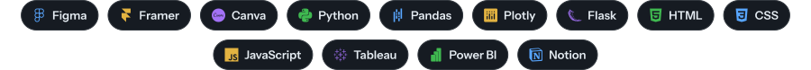
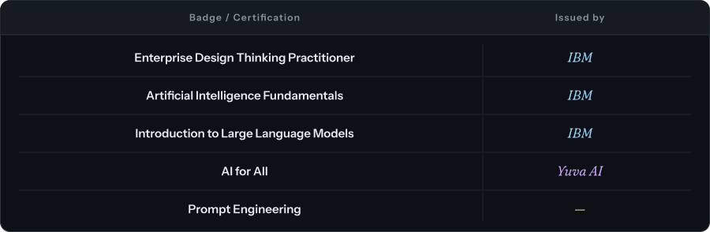
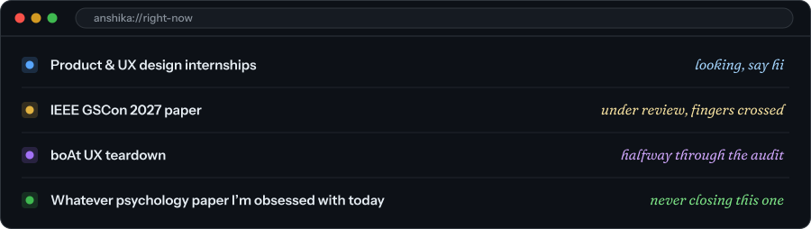

<!--
  Profile README for github.com/anshikam1245  (repo: anshikam1245/anshikam1245)
  Keep the /assets folder next to this file.
-->

 

&nbsp;
&nbsp;
&nbsp;
&nbsp;
&nbsp;

<picture>
  <source media="(prefers-color-scheme: dark)" srcset="./assets/divider-dark.svg"/>
  
</picture>

<picture>
  <source media="(prefers-color-scheme: dark)" srcset="./assets/h-hi-dark.svg"/>
  
</picture>

I've always been more curious about *why* something works than just building it - which is probably why I ended up somewhere between research, design and analysis instead of picking just one.

I'm a final-year B.Tech (ICT) student at Adani University, making my way from tech into UX and product design. I'm most interested in where user behaviour, data and interface decisions meet. Sometimes that looks like auditing real products to figure out where design quietly fails people. Sometimes it looks like a research paper where I spent more time designing ways to verify if the model was right than making it look impressive on paper.

Open to roles where analytical thinking and design sensibility both matter.

<picture>
  <source media="(prefers-color-scheme: dark)" srcset="./assets/divider-dark.svg"/>
  
</picture>

<picture>
  <source media="(prefers-color-scheme: dark)" srcset="./assets/h-work-dark.svg"/>
  
</picture>

<table>
<tr>
<td width="50%" valign="top">

<picture>
  <source media="(prefers-color-scheme: dark)" srcset="./assets/p-pinterest-dark.svg"/>
  
</picture>

A redesign of Pinterest's discovery and save flows. I started by finding where the experience quietly fails people (heuristic evaluation, competitor teardowns) and only then moved to high-fidelity prototypes in Figma.

</td>
<td width="50%" valign="top">

<picture>
  <source media="(prefers-color-scheme: dark)" srcset="./assets/p-netflix-dark.svg"/>
  
</picture>

An EDA-driven dashboard on Netflix content trends, genre patterns and release timing. Python and Flask underneath, Plotly and Seaborn on top, and the data came first, the charts second.

</td>
</tr>
<tr>
<td width="50%" valign="top">

<picture>
  <source media="(prefers-color-scheme: dark)" srcset="./assets/s-pinterest-dark.svg"/>
  
</picture> 
<a href="https://www.behance.net/gallery/254669803/Pinterest-UX-Case-Study-Heuristic-Audit-Redesign">Read the case study</a>

</td>
<td width="50%" valign="top">

<picture>
  <source media="(prefers-color-scheme: dark)" srcset="./assets/s-netflix-dark.svg"/>
  
</picture> 
<a href="https://github.com/anshikam1245/netflix-insights-dashboard">View the repo</a>

</td>
</tr>
<tr>
<td width="50%" valign="top">

<picture>
  <source media="(prefers-color-scheme: dark)" srcset="./assets/p-boat-dark.svg"/>
  
</picture>

Taking apart boAt's e-commerce experience to see where the design helps people buy and where it quietly gets in their way.

</td>
<td width="50%" valign="top">

<picture>
  <source media="(prefers-color-scheme: dark)" srcset="./assets/p-web-dark.svg"/>
  
</picture>

Five builds from scratch, where I test design ideas in the browser instead of only in Figma: animation, interaction and responsive layouts.

</td>
</tr>
<tr>
<td width="50%" valign="top">

<picture>
  <source media="(prefers-color-scheme: dark)" srcset="./assets/s-boat-dark.svg"/>
  
</picture>

</td>
<td width="50%" valign="top">

<picture>
  <source media="(prefers-color-scheme: dark)" srcset="./assets/s-web-dark.svg"/>
  
</picture> 
<a href="https://github.com/anshikam1245">Browse the builds</a>

</td>
</tr>
<tr>
<td colspan="2" valign="top">

<picture>
  <source media="(prefers-color-scheme: dark)" srcset="./assets/p-research-dark.svg"/>
  
</picture>

An NLP paper on classifying mental-health text. My part was mostly the unglamorous bit: building evaluation frameworks to check whether the model was actually right. That habit of verifying before trusting carries straight into how I approach design problems.

</td>
</tr>
<tr>
<td colspan="2" valign="top">

<picture>
  <source media="(prefers-color-scheme: dark)" srcset="./assets/s-research-dark.svg"/>
  
</picture>

</td>
</tr>
</table>

<picture>
  <source media="(prefers-color-scheme: dark)" srcset="./assets/divider-dark.svg"/>
  
</picture>

<picture>
  <source media="(prefers-color-scheme: dark)" srcset="./assets/h-toolkit-dark.svg"/>
  
</picture>

<table align="center">
<tr><td><b>Product</b></td><td>Problem framing, user stories, feature prioritisation, roadmapping</td></tr>
<tr><td><b>Design</b></td><td>Wireframing, prototyping, interaction design, branding</td></tr>
<tr><td><b>Research</b></td><td>UX audits, heuristic evaluation, user flows, evaluation frameworks</td></tr>
<tr><td><b>Data</b></td><td>EDA, statistics, dashboards</td></tr>
<tr><td><b>AI</b></td><td>AI-assisted workflows that get me from research to prototype faster, without skipping the reasoning in between</td></tr>
</table>

<picture>
  <source media="(prefers-color-scheme: dark)" srcset="./assets/divider-dark.svg"/>
  
</picture>

<picture>
  <source media="(prefers-color-scheme: dark)" srcset="./assets/h-credentials-dark.svg"/>
  
</picture>

I collect certifications the way some people collect stamps, mostly because I can't stop asking why something works before I'll trust that it does. I treat them less as credentials and more as checkpoints: proof I sat with an idea long enough to test it, not just skim it.

<a href="https://www.credly.com/users/anshika-mittal.120405">View on Credly</a>

<picture>
  <source media="(prefers-color-scheme: dark)" srcset="./assets/divider-dark.svg"/>
  
</picture>

<picture>
  <source media="(prefers-color-scheme: dark)" srcset="./assets/h-offclock-dark.svg"/>
  
</picture>

I read an unreasonable amount for someone ungraded on it: UX, psychology, philosophy, neuroscience, monetary policy, medieval history, whatever paper I'm obsessed with today. I'm drawn to how buildings and cities are designed as much as how apps are, and I'll happily talk about astronomy, art or a music form I just picked up.

Van Gogh is the reason the sky up top looks like that (Monet is a close second). Otherwise I'm sketching, solving the murder mystery before the reveal, or rereading Harry Potter, ideally with rain, coffee and winter involved. Not really a writer, just too many tabs open.

<picture>
  <source media="(prefers-color-scheme: dark)" srcset="./assets/divider-dark.svg"/>
  
</picture>

<picture>
  <source media="(prefers-color-scheme: dark)" srcset="./assets/h-tabs-dark.svg"/>
  
</picture>

 

